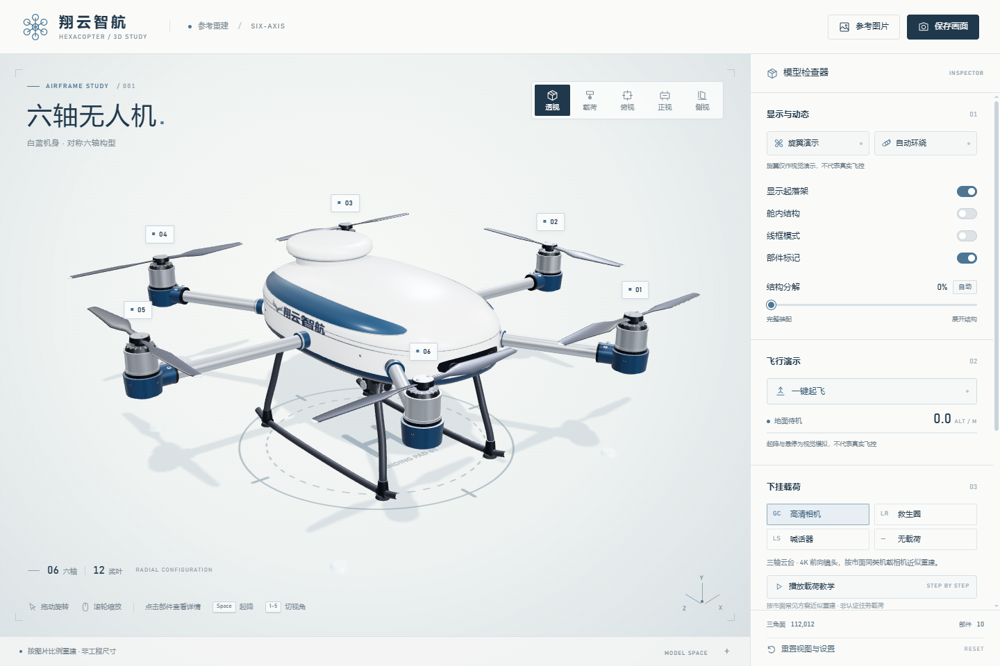
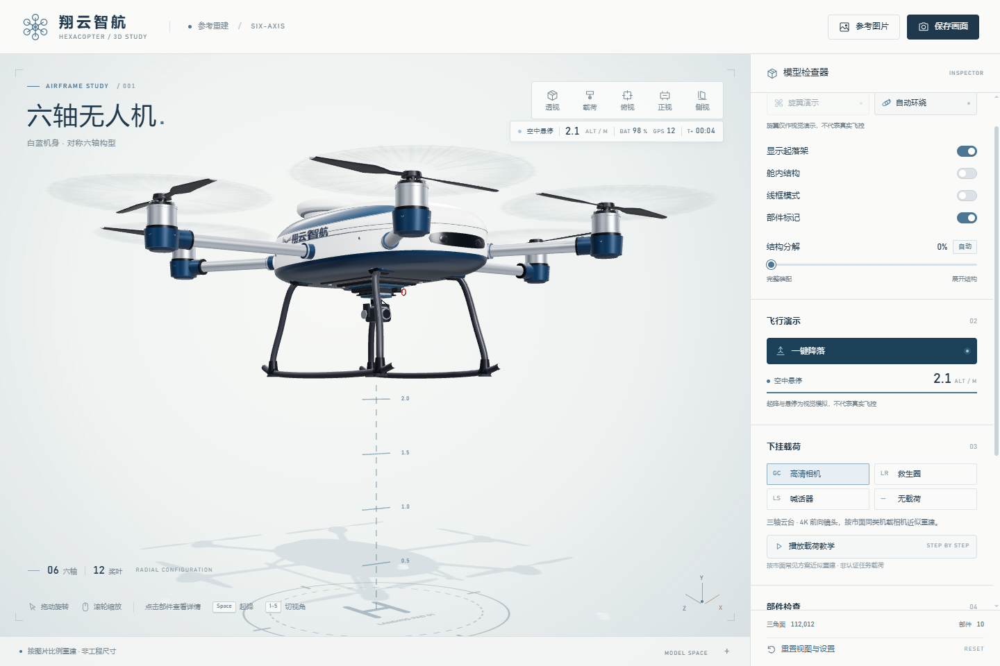
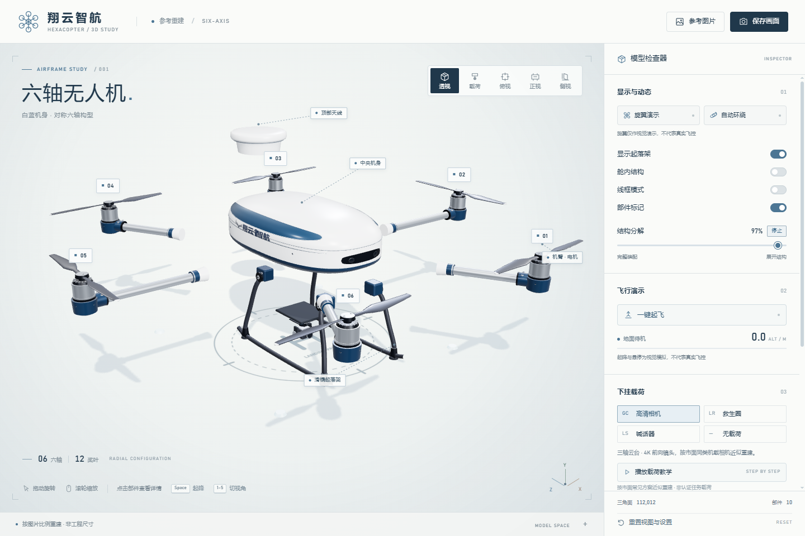
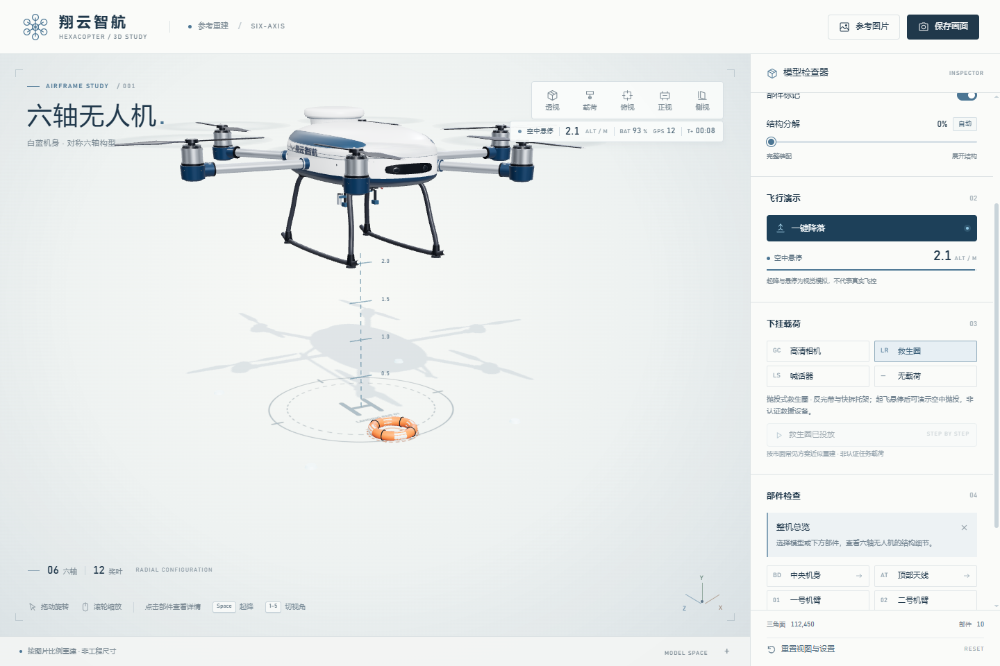
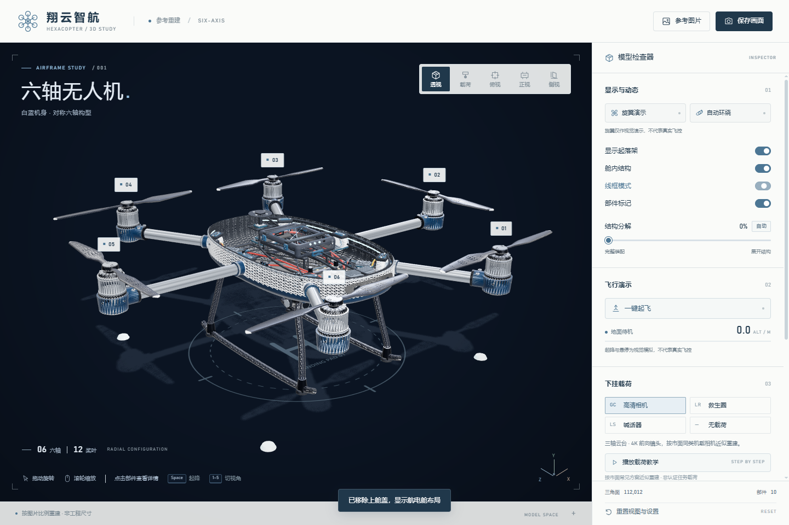
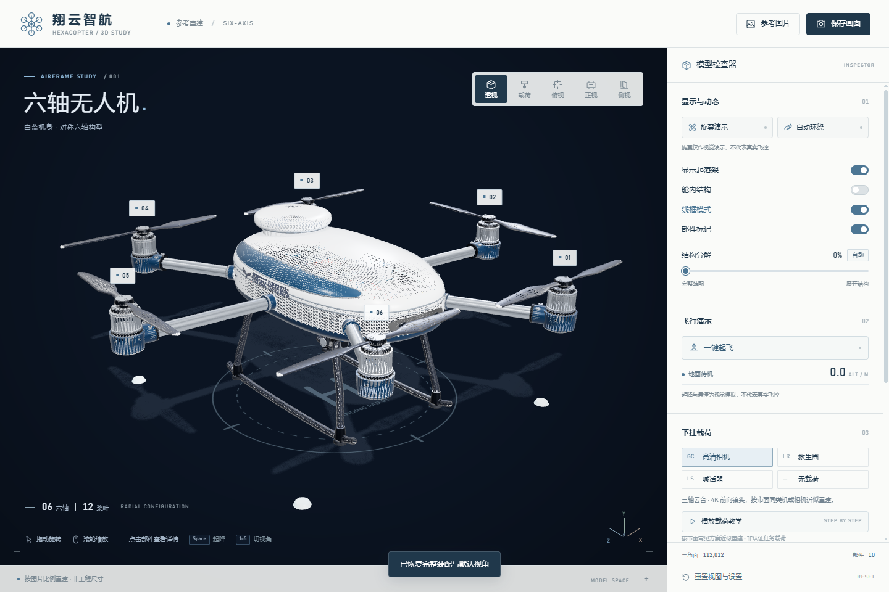

# hexacopter-studio · 六轴无人机三维结构查看器

基于参考图片、用 **纯代码程序化建模** 重建的白蓝配色六轴无人机交互式 3D 查看器（品牌演示名「翔云智航」）。技术栈为 **Three.js + TypeScript + Vite**，不依赖任何外部模型文件，已发布为 Qoder 私有站点。

> 在线演示：<https://hexacopter-studio-ntoojfoe4m9.qoder.website>（私有站点，需授权访问）
>
> 说明：模型按图片比例近似重建，**非工程尺寸**；起飞、降落、抛投等动画均为**视觉模拟**，不代表真实飞控逻辑。



## 实现了哪些功能

### 程序化模型
- 6 机臂 / 6 电机 / 12 桨叶的对称六轴构型，白蓝机身、顶部天线、航电舱、滑橇起落架
- 约 11.2 万三角面、10 个可检查部件总成，全部由代码生成，无 glTF/贴图模型下载
- 部件标记（01–06 编号 + 名称引线），点击模型或部件列表可查看结构详情

### 视图与交互
- 拖动旋转、滚轮缩放、射线拾选部件
- 5 个相机预设：透视 / 载荷 / 俯视 / 正视 / 侧视
- 键盘快捷键：`Space` 起降、`1–5` 切视角、方向键环绕、`+/−` 缩放
- 显示开关：起落架、舱内结构（航电舱透视）、线框模式、部件标记
- 结构分解滑杆（0–100%）+ 自动分解演示，带引线标注
- 一键保存画面为 PNG、参考图片对照弹窗、重置视图与设置

### 飞行演示（视觉模拟）
- 一键起飞 / 降落：旋翼模糊桨盘、停机坪指示灯、高度刻度线、起降扬尘、缓冲着陆
- 实时 HUD：高度 ALT、电量 BAT、GPS 星数、任务计时 T+
- 起飞/悬停/降落状态机，与载荷教学、分解动画互斥保护



### 下挂载荷与教学
- 三种可切换载荷：高清相机（三轴云台）、救生圈（反光带 + 快拆托架）、喊话器，或无载荷
- 每种载荷配套分步教学动画，可暂停 / 重播 / 关闭



### 救生圈空中抛投（视觉模拟）
- 悬停后解锁 → 推出 → 自由落体 → 落入目标圈（涟漪反馈）→ 一键回收
- 完整抛投状态机与动画时序，桌面端与移动端均可演示



### 移动端与无障碍
- 响应式布局：≤760px 堆叠排布，≤560px 检查器分区默认折叠 + 「展开全部 / 全部收起」
- 折叠按钮带 `aria-expanded` / `aria-controls`，约 48px 触控热区；桌面端布局不受影响
- 支持 `prefers-reduced-motion`：自动关闭环绕、粒子等持续动效

| 移动端折叠检查器 | 移动端飞行演示 |
| --- | --- |
|  |  |

### 其他视图
| 舱内结构（航电舱） | 线框模式 |
| --- | --- |
|  |  |

## 用了哪些 Skill

| Skill | 在本项目中的作用 |
| --- | --- |
| `img2threejs` | 图片 → 程序化 Three.js 模型的核心管线：分阶段雕刻（blockout → 结构 → 形态 → 材质 → 光照 → 交互 → 优化）、规格契约、截图与参考图逐轮对比自校正 |
| `frontend-design` | 页面视觉方向与 UI 质感：航电仪表风格排版、配色、留白、微交互与响应式细节 |
| `sites:sites-building` | Qoder Sites 站点开发流程：项目结构、Nudge 设计变量（外观/圆角/间距/字体/动效）、构建产物与设计工作台注册 |
| `sites:sites-hosting` | 发布上线：prepare → publish → 验证 published + 私有访问范围，保持站点私有 |

## 本地运行

```bash
npm install
npm run dev      # 开发预览 http://127.0.0.1:5174/
npm run build    # 类型检查 + 生产构建（输出 dist/）
```

自动化验收脚本（无头 Chrome + CDP，截图与断言输出到 `evidence/`）：

```bash
node evidence/browser-qa.mjs        # 桌面/移动端布局、交互与折叠检查（33 项断言）
node evidence/animation-probe.mjs   # 飞行/载荷/抛投动画时序与 reduced-motion 检查
```

## 项目结构

```
index.html            页面骨架（查看器 + 模型检查器）
src/main.ts           交互逻辑、状态机、动画与 HUD
src/createObjectModel.ts  程序化无人机模型工厂
src/style.css         样式与响应式/折叠规则（消费 Nudge 设计变量）
evidence/             浏览器 QA 脚本、演示截图与动画探针
```